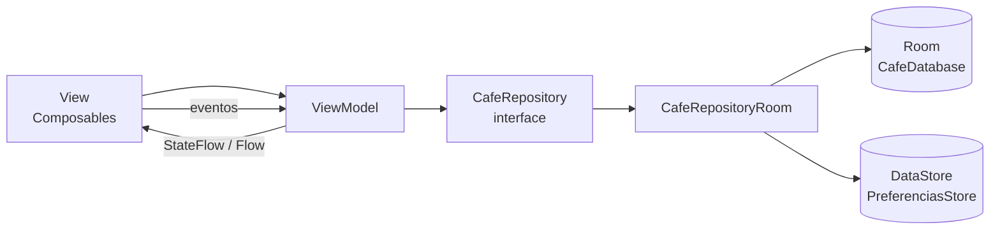

# CafeCampus 

App de pedidos para la cafetería del campus: un **Estudiante** arma su pedido, lo confirma y sigue su estado en tiempo real; un **Administrador** atiende los pedidos, gestiona el menú y revisa las ventas del día. Arquitectura **MVVM + Room + Jetpack Compose**, con dos perfiles en el mismo dispositivo, sesión recordada con DataStore y **pago con QR interoperable de Yape/Plin con el monto automático**.

## Estructura de paquetes

```
com.quispe.cafeCampus
├── data
│   ├── local
│   │   ├── dao/          ProductoDao, UsuarioDao, PedidoDao
│   │   ├── entity/       Producto, Usuario, Pedido, DetallePedido
│   │   ├── relation/     PedidoConDetalle
│   │   ├── CafeDatabase.kt · DatosIniciales.kt
│   ├── pago/             QrEmvCo (generador de payloads EMVCo + CRC16)
│   ├── prefs/            PreferenciasStore (DataStore: perfil, modo oscuro, recibir pedidos, QR de pago)
│   └── repository/       CafeRepository (interface) · CafeRepositoryRoom
├── model/                Rol, EstadoPedido, ItemCarrito
├── viewmodel/            SesionViewModel, MenuViewModel, PedidosClienteViewModel,
│                         PanelAdminViewModel, PedidosAdminViewModel, MenuAdminViewModel,
│                         RegistroViewModel, ReporteViewModel, PagoViewModel,
│                         CafeViewModelFactory
├── ui
│   ├── theme/            Color, Type, Theme (tema según perfil)
│   ├── components/       AppTopBar, CafeButton, CafeTextField, EstadoChip,
│   │                     ProductoIcono, ProductoCard, PedidoCard, StepperEstado
│   ├── cliente/          Splash, Login, Registro, Menu, DetalleProducto, ConfirmarPedido,
│   │                     Seguimiento, MisPedidos, PagoQr
│   ├── admin/            Panel, PedidosAdmin, DetallePedidoAdmin, MenuAdmin,
│   │                     FormularioProducto, Reporte, Ajustes
│   └── navigation/       Rutas, NavCafe (grafo completo con navegación inferior)
├── CafeApp.kt · MainActivity.kt
```

## Configurar el QR de pago (Yape/Plin)

El QR de cobro **no está en el repositorio**. Para precargarlo, agrega a `local.properties`
(ignorado por Git) el texto de tu QR, obtenido al escanearlo con cualquier lector:

```properties
pago.qr.payload=000201010211...6304XXXX
```

También se puede pegar o cambiar desde la app: **Perfil → Ajustes → Pagos con QR** (administrador).
Si la billetera no respeta el monto automático, la pantalla de pago tiene "Usar QR sin monto".

## Diagrama MVVM



- **View** solo observa `StateFlow` y emite eventos (clics, formularios).
- **ViewModel** expone el estado y llama al repositorio dentro de `viewModelScope`.
- **Repository** es la única puerta a los datos (Room o DataStore), lo que permite cambiar la implementación sin tocar la UI.

## Capturas

Espacios reservados para las 6 capturas (3 por perfil). Coloca los archivos en `docs/`:

| Cliente | Administrador |
|---|---|
|  |  |
|  |  |
|  |  |

## Para pensar

1. **¿Por qué el Repository es una interface?** Para desacoplar la UI/ViewModel de la fuente de datos: hoy es Room y mañana puede ser una API, cambiando solo la implementación.
2. **¿Por qué crearPedido es suspend y observarPedidosCliente es Flow?** `suspend` es una escritura única que termina; `Flow` mantiene una consulta viva que emite cada vez que la tabla cambia.
3. **¿Qué pasaría si dos perfiles usaran bases de datos distintas?** No habría datos compartidos: los pedidos creados por el estudiante no los vería el administrador, rompiendo el flujo.
4. **¿Qué cambiaría si los datos vivieran en un servidor?** Solo `CafeRepositoryRoom` se reemplazaría por un `CafeRepositoryApi` (Retrofit); ViewModel y vistas no se modifican.
