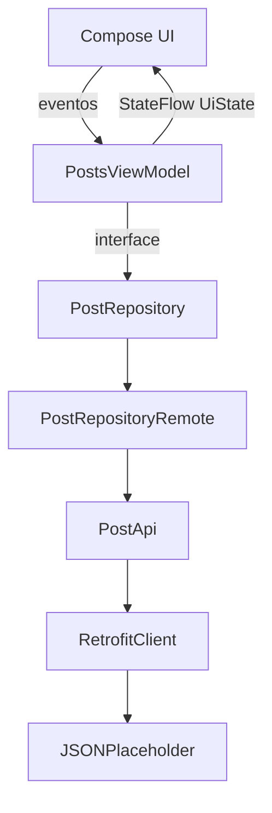

# MuroCampus

Aplicación Android nativa con Kotlin y Jetpack Compose para consultar, filtrar, leer y crear publicaciones usando JSONPlaceholder. La Fase 1 organiza el acceso a datos con MVVM + Repository, Retrofit, OkHttp y kotlinx.serialization.

## Estructura

```text
app/src/main/java/com/tecsup/murocampus/
├── data/
│   ├── PostRepository.kt
│   └── remote/
│       ├── PostApi.kt
│       └── RetrofitClient.kt
├── model/
│   └── Modelos.kt
├── ui/
│   ├── MuroCampusApp.kt
│   ├── PantallaCrear.kt
│   ├── PantallaDetalle.kt
│   ├── PantallaLista.kt
│   └── UiState.kt
├── viewmodel/
│   └── PostsViewModel.kt
└── MainActivity.kt
```

## Arquitectura MVVM



La UI solo observa flujos con `collectAsStateWithLifecycle()` y comunica acciones al ViewModel. El ViewModel depende únicamente de `PostRepository`; la implementación remota encapsula Retrofit y entrega `Result`. Las cancelaciones de coroutines se relanzan.


## Capturas

Agrega aquí cinco capturas del emulador antes de entregar:

1. Lista de publicaciones: `docs/capturas/01-lista.png`
2. Filtro por usuario: `docs/capturas/02-filtro.png`
3. Detalle y comentarios: `docs/capturas/03-detalle.png`
4. Formulario de publicación: `docs/capturas/04-crear.png`
5. Publicación exitosa: `docs/capturas/05-publicado.png`

## Para pensar

Respuestas preparadas a partir de los requisitos transcritos para esta implementación. Contrasta la redacción con las seis preguntas exactas de la guía antes de entregar.

1. **¿Por qué se usa una interfaz `PostRepository`?** Desacopla el ViewModel de Retrofit y permite cambiar o sustituir la fuente de datos sin modificar la lógica de presentación.
2. **¿Qué diferencia hay entre `@Path` y `@Query`?** `@Path` reemplaza un segmento de la ruta, como `/posts/3`; `@Query` agrega parámetros, como `/posts?userId=3`.
3. **¿Para qué sirve `ignoreUnknownKeys`?** Permite deserializar respuestas aunque el servidor incluya propiedades que el modelo de la aplicación no declara.
4. **¿Por qué el repositorio devuelve `Result<T>`?** Convierte resultados y errores de red en una respuesta que la capa superior puede representar como éxito o error de UI, sin dejar escapar excepciones ordinarias.
5. **¿Por qué se relanza `CancellationException`?** La cancelación forma parte del control estructurado de coroutines; tratarla como un error normal puede impedir que una tarea cancelada termine correctamente.
6. **¿Qué aportan `StateFlow` y `UiState`?** Exponen estado observable y explícito (cargando, error o éxito), haciendo que Compose se redibuje al cambiar los datos y pueda mostrar la pantalla adecuada.

## Secuencia sugerida de commits

1. `chore(red): agrega permiso de internet y dependencias de Retrofit`
2. `feat(model): agrega Post, Comentario y NuevoPost`
3. `feat(api): define la interface PostApi con GET y POST`
4. `feat(red): crea RetrofitClient con OkHttp y conversor JSON`
5. `feat(data): agrega PostRepository que devuelve Result`
6. `feat(ui): lista de publicaciones con estados Cargando, Exito y Error`
7. `feat(detalle): muestra publicacion y comentarios con Path`
8. `feat(filtro): filtra publicaciones por usuario con Query`
9. `feat(crear): publica una nueva publicacion con POST y Body`
10. `docs: agrega README con estructura y capturas`

## Compilar

Abre el directorio en Android Studio con Android SDK 36 instalado y sincroniza Gradle.

### Prueba temporal del Paso 4

Para probar el cliente antes de crear Repository, agrega temporalmente estos imports y el bloque dentro de `onCreate`, después de `super.onCreate(savedInstanceState)`:

```kotlin
import android.util.Log
import androidx.lifecycle.lifecycleScope
import kotlinx.coroutines.launch

lifecycleScope.launch {
    try {
        val publicaciones = RetrofitClient.api.listar()
        Log.d("MuroCampus", "Publicaciones recibidas: ${publicaciones.size}")
    } catch (e: Exception) {
        Log.e("MuroCampus", "Error consultando publicaciones", e)
    }
}
```

Elimina ese bloque y sus imports temporales al terminar la prueba, antes de crear el commit `feat(red): crea RetrofitClient con OkHttp y conversor JSON`.

## Fase 2 en mejora-ia

La rama `mejora-ia` agrega búsqueda local por título, edición con PUT, eliminación con DELETE y el encabezado `Accept: application/json`. JSONPlaceholder simula escrituras y borrados, por lo que los cambios se reflejan en la lista en memoria pero no persisten al recargar desde el servidor.
