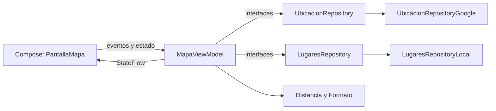
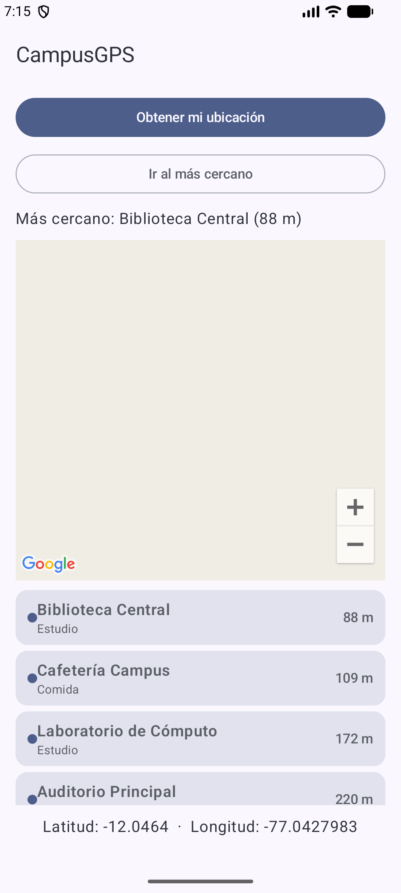

# CampusGPS

Aplicación Android de demostración para obtener la ubicación del dispositivo y ordenar cinco lugares ficticios del campus por distancia. Está construida con Kotlin, Jetpack Compose, Material 3, Maps Compose y Google Play Services Location.

## Configuración

1. En Google Cloud habilita **Maps SDK for Android** y crea una clave restringida al paquete `com.quispe.campusgps` y a la huella SHA-1 de la aplicación.
2. Agrega la clave localmente a `local.properties` (este archivo está ignorado por Git):

   ```properties
   MAPS_API_KEY=TU_CLAVE_DE_MAPS
   ```

3. Sincroniza Gradle y ejecuta la app en un emulador con Google Play. Para reproducir las distancias de ejemplo, establece la ubicación del emulador en `-12.0464, -77.0428`.

La clave se inyecta con `manifestPlaceholders`; nunca se escribe en código fuente ni se incluye en commits. Si se expone, revócala en Google Cloud y genera otra.

## Estructura

```text
com.quispe.campusgps/
├── MainActivity.kt
├── model/Modelos.kt
├── data/
│   ├── UbicacionRepository.kt
│   ├── UbicacionRepositoryGoogle.kt
│   ├── LugaresRepository.kt
│   └── LugaresRepositoryLocal.kt
├── util/
│   ├── Distancia.kt
│   └── Formato.kt
├── viewmodel/
│   ├── MapaViewModel.kt
│   └── CampusViewModelFactory.kt
└── ui/
    ├── PantallaMapa.kt
    ├── MapaUbicacion.kt
    ├── ListaLugares.kt
    ├── MensajeError.kt
    └── theme/
```

## Arquitectura



La pantalla solo consume el ViewModel. El ViewModel usa interfaces, mantiene estado y calcula distancias; no recibe un `Context`. La implementación Google encapsula `FusedLocationProviderClient`.

## Lugares ficticios

| ID | Lugar | Categoría | Coordenadas |
|---:|---|---|---|
| 1 | Biblioteca Central | Estudio | -12.0460, -77.0435 |
| 2 | Cafetería Campus | Comida | -12.0470, -77.0420 |
| 3 | Laboratorio de Cómputo | Estudio | -12.0455, -77.0415 |
| 4 | Auditorio Principal | Eventos | -12.0480, -77.0440 |
| 5 | Estacionamiento Norte | Servicios | -12.0440, -77.0430 |

## Capturas y verificación

La captura del emulador con la ubicación de Lima muestra las distancias ordenadas (Biblioteca Central primero, alrededor de 88 m). La capa cartográfica requiere una clave de Maps configurada en el `local.properties` local.



Las capturas de permiso, marcadores sobre el mapa y error deben tomarse de nuevo en el emulador después de configurar la clave. En esta sesión el AVD llegó a mostrar el diálogo de permiso y el error de denegación, pero el proceso de Android dejó de responder antes de guardar una captura final fiable. No se incluyen imágenes de ejemplo como si fueran capturas de la app.

### Verificación realizada

- `.\gradlew.bat assembleDebug`: compilación completada correctamente.
- AVD API 37 con Google Play: ubicación de Lima obtenida y distancias ordenadas en pantalla.
- Permiso: diálogo de Android solicitado; el flujo de denegación dejó la app abierta.
- No se pudo verificar la tesela de Maps ni los marcadores del mapa porque no hay `MAPS_API_KEY` configurada en `local.properties`.
- No se simuló un dispositivo sin Google Play Services.

## Para pensar

1. **¿Por qué `FusedLocationProviderClient` está en el Repository y no en el ViewModel?** El Repository encapsula el servicio de Android y adapta sus respuestas al contrato de datos. Así el ViewModel depende de una interfaz y no necesita conocer `Context` ni APIs de ubicación.
2. **¿Qué diferencia hay entre el permiso y la clave de Maps?** El permiso autoriza el acceso a la ubicación del dispositivo. La clave autoriza el uso de Maps SDK. Sin permiso no se obtiene la ubicación; sin una clave válida, el mapa no carga sus teselas.
3. **¿Por qué la clave va en `local.properties`?** Mantiene el secreto fuera del código y del repositorio. Si se subiera por error, hay que revocarla y reemplazarla.
4. **¿Dónde se calcula la distancia y por qué no en el Composable?** En `MapaViewModel`, usando la función de `util/Distancia.kt`, para que la UI solo represente el estado y no mezcle presentación con lógica.
5. **¿Qué pasa si el usuario niega el permiso dos veces?** Android puede dejar de mostrar el diálogo. La aplicación mantiene el estado de error y ofrece abrir los ajustes de CampusGPS para conceder el permiso.
