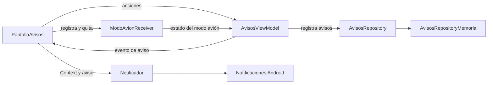
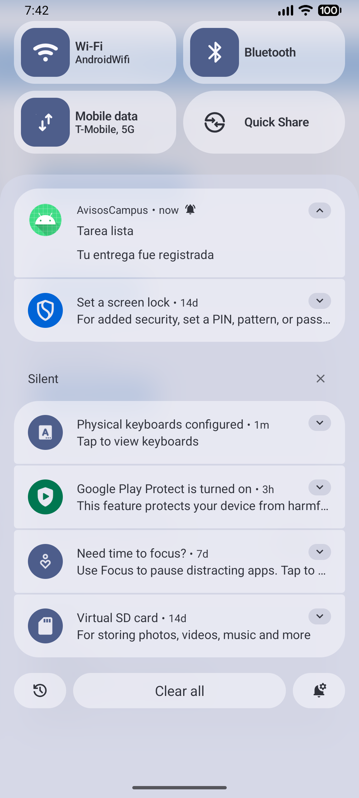
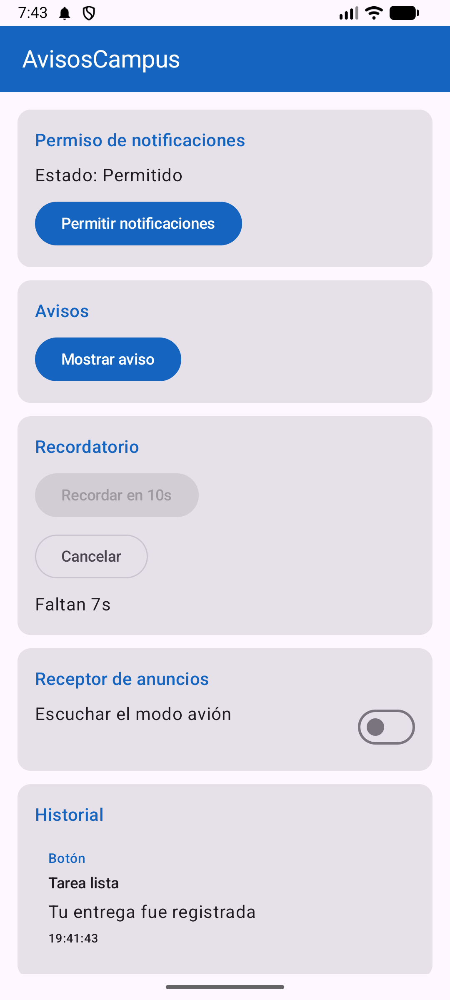
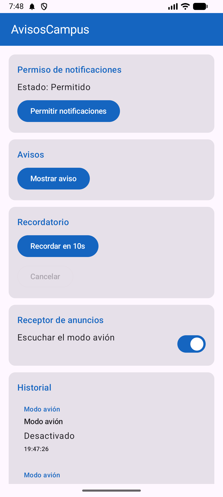
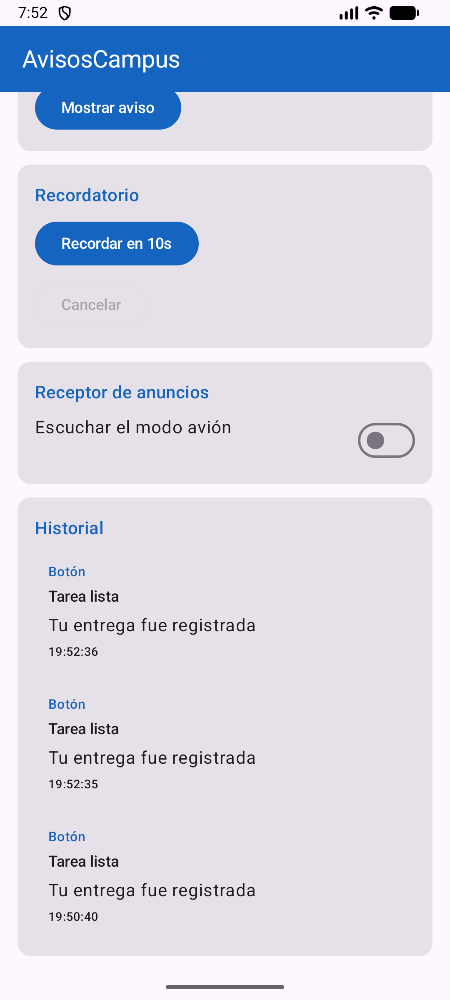
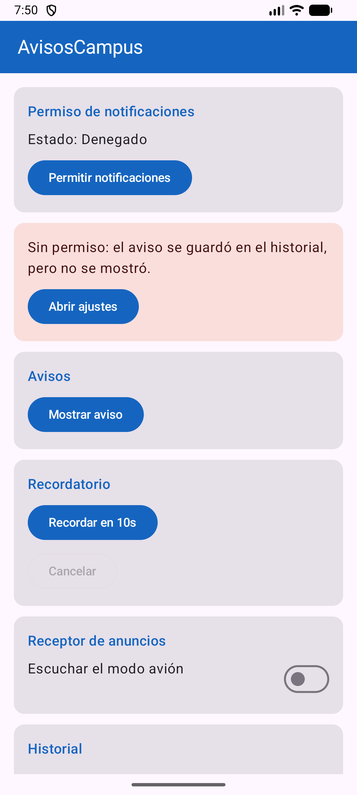

# AvisosCampus

Aplicación Android desarrollada con Kotlin, Jetpack Compose y Material 3. Muestra notificaciones locales, programa recordatorios de diez segundos, escucha cambios del modo avión y registra los avisos en un historial en memoria.

## Estructura del proyecto

```text
app/src/main/java/com/quispe/avisoscampus/
├── AvisosApp.kt
├── MainActivity.kt
├── data/
│   └── AvisosRepository.kt
├── model/
│   └── Modelos.kt
├── notificacion/
│   └── Notificador.kt
├── receiver/
│   └── ModoAvionReceiver.kt
├── ui/
│   ├── HistorialAvisos.kt
│   ├── PantallaAvisos.kt
│   └── theme/
└── viewmodel/
    ├── AvisosViewModel.kt
    └── AvisosViewModelFactory.kt
```

## Arquitectura MVVM + Repository



El ViewModel actualiza el estado y registra avisos mediante el repositorio. La pantalla recoge los eventos y llama al notificador, ya que es la capa que dispone de `Context`. El receptor comunica el cambio del modo avión al ViewModel y se desregistra cuando deja de estar activo en la pantalla.

## Capturas de la aplicación

### Notificación en el panel



### Cuenta regresiva del recordatorio



### Receptor del modo avión



### Historial de avisos



### Permiso denegado



## Respuestas para pensar

1. **¿Por qué una notificación necesita un canal y un permiso?**
   El canal permite configurar cómo Android presenta las notificaciones de la app. En Android 13 o superior, la app también debe pedir permiso. Sin canal, la notificación no se puede clasificar; sin permiso, Android no la muestra.

2. **¿Por qué el ViewModel emite un evento en vez de mostrar la notificación?**
   El ViewModel no debe conocer `Context` ni gestionar APIs de notificaciones. Emite un evento y la pantalla, que sí tiene acceso al contexto, se encarga de llamar al notificador.

3. **¿Qué pasa si se usa el mismo ID para dos notificaciones?**
   La nueva notificación puede reemplazar a la anterior. El repositorio asigna un ID distinto a cada aviso.

4. **¿Por qué `onReceive` debe ser corto y hay que quitar el receptor?**
   `onReceive` corre en el hilo principal y debe terminar pronto. Desregistrar el receptor al salir evita que siga escuchando y ayuda a prevenir fugas de memoria.

5. **¿Cuándo usar una notificación local y cuándo una notificación push de Firebase?**
   Una notificación local sirve para avisos que la app puede generar en el dispositivo, como un recordatorio. Una push de Firebase sirve para comunicar un evento enviado desde un servidor, incluso si la app no lo generó localmente.
